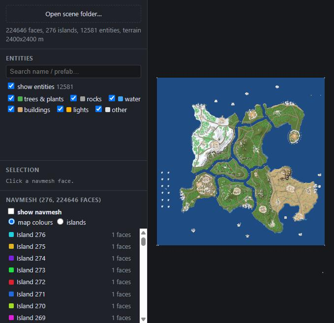

# Bannerlord Scene Viewer

A small, editor-free viewer for Mount & Blade II: Bannerlord scenes. Check navmesh coverage, find stuck spots and look up entities without opening the Modding Kit.



## Features

- **Terrain** from `terrain.bin`: real heights and ground layers, hillshaded, top-down.
- **Water**: sea and rivers from water planes (and the global water level when the scene has one), darker where deeper.
- **Navmesh** from `navmesh.bin`, drawn over the terrain. Can be switched on and off.
- **Disconnected navmesh parts** ("islands"): each island gets its own colour, small ones are ringed in red, and the list jumps to any island. Small islands are usually spots where agents get stuck.
- **Entities** from `scene.xscene`: every entity with a position, coloured by kind (trees and plants, rocks, water, buildings, lights, other). Each kind can be hidden.
- **Search** by name or prefab, with matches highlighted. Hover a dot for its name, prefab and position.
- **Click a navmesh face** to see its id, flags, vertex count and island. Overlapping layers are all listed.

## Download

Get `scene-viewer.exe` from [Releases](../../releases). No install, no .NET needed. It uses Microsoft Edge WebView2, which is built into Windows 10 and 11.

## Usage

- **Drop a scene folder onto `scene-viewer.exe`**, for example `Modules\<module>\SceneObj\<scene>`. The viewer opens in its own window with the scene loaded.
- Or start the exe and use **Open scene folder…**, or drag a scene folder into the window.

Only `navmesh.bin`, `scene.xscene` and `terrain.bin` are read from the folder. Nothing is written.

Controls: drag to pan, mouse wheel to zoom, click a face to inspect it.

## Limitations

- Ground colours are guessed from each layer's texture name (grass, sand, rock, snow, road...). Real textures live in the game's `.tpac` packages, which are not read yet.
- Entities are dots, not models.
- Water is found from plane entities with a water material. Rivers made from custom meshes are not shown.
- Read-only: nothing is ever written back.

## Building

The viewer itself is `scene-viewer.html`. The exe is a small WinForms + WebView2 window that embeds it:

```
cd launcher
dotnet publish -c Release -o ../dist
```

Needs the .NET 8 SDK. The output is a self-contained single-file exe.

## File formats

See [FORMATS.md](FORMATS.md) for the `navmesh.bin` and `terrain.bin` layouts.

## License

MIT, see [LICENSE](LICENSE).
